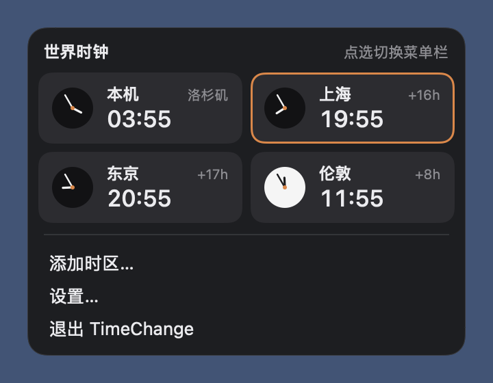
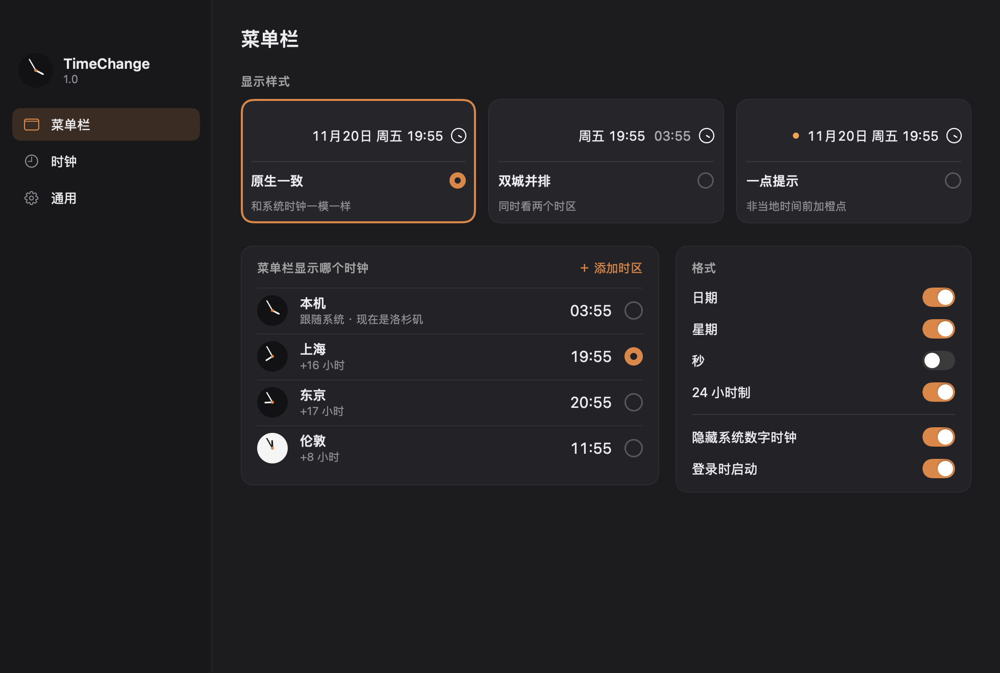
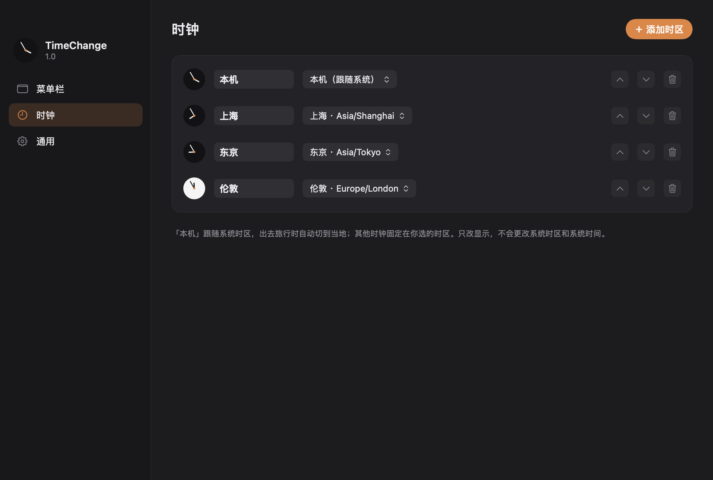

# TimeChange

**macOS 菜单栏多时区时钟 —— 只改显示，不改系统时区和系统时间。**

经常出差旅行？macOS 右上角的时间会自动切到当地，这是对的；但有时你又想看看家里、或者另一个国家现在几点。TimeChange 用一个和系统原生时钟外观一致的菜单栏时间替代它：你可以随时切换成任意时区显示，也可以同时显示两个时区，而**系统时区和系统时间完全不受影响**。

[English](#english)

<p align="center">
  
</p>





## 功能

- **原生外观**：菜单栏时间的字体、字号、格式与系统时钟一致（`11月20日 周五 03:38`）。
- **三种显示样式**
  - **原生一致**：和系统时钟一模一样，只是时区由你决定。
  - **双城并排**：`周五 03:38  19:38`，同时看两个时区，第二个时间淡色显示。
  - **一点提示**：显示的不是本机时间时，前面加一个橙色小点提醒。
- **下拉面板**：点击菜单栏时间，弹出世界时钟卡片，昼夜表盘一目了然，点一下即可切换菜单栏显示的时区。
- **本机时钟跟随系统**：旅行时自动切到当地时区。
- **默认常用时区**：本机、上海、东京、伦敦，可任意添加、改名、排序、删除（支持中英文搜索城市）。
- **格式开关**：日期、星期、秒、24 小时制。
- **隐藏系统数字时钟**：运行时把系统时钟切换为「模拟」小图标，退出时自动恢复（只改显示样式）。
- **登录时启动**、只允许运行一个实例、不占用 Dock。

## 安装

需要 macOS 14 及以上、Xcode 命令行工具（Swift 5.9+）。

```bash
git clone https://github.com/mcporda/TimeChange.git
cd TimeChange
./build.sh
open ~/Applications/TimeChange.app
```

`build.sh` 会编译并以 ad-hoc 签名生成 `TimeChange.app`，安装到 `~/Applications`。

> 提示：按住 ⌘ 拖动菜单栏上的时间，可以调整它的位置。

## 工作原理

- 菜单栏项是一个 `NSStatusItem`，每秒对齐整秒刷新；时间用 `DateFormatter` 按所选时区格式化，从不调用任何修改系统时区 / 时间的 API。
- 「隐藏系统数字时钟」只写入 `com.apple.menuextra.clock IsAnalog`（系统时钟的显示样式），并在退出时恢复原值。
- 界面使用 SwiftUI，全部代码在 [`Sources/main.swift`](Sources/main.swift)，无第三方依赖。

## 已知限制

- macOS 不允许第三方 App 删除或修改系统时钟，「模拟」小图标是系统能提供的最小样式。
- 通过「强制退出」结束 TimeChange 时，系统时钟样式不会被自动恢复；重新打开再正常退出即可。

## 开发

```bash
./build.sh                                                     # 构建并安装
~/Applications/TimeChange.app/Contents/MacOS/TimeChange --snapshot docs   # 重新生成 README 截图
```

欢迎提 Issue 和 PR。

## License

[MIT](LICENSE)

---

## English

**A multi-time-zone menu bar clock for macOS that changes only what you see — never your system time zone or clock.**

TimeChange puts a native-looking clock in the menu bar that can show any time zone. Switch between your Mac's local time (which follows you as you travel), home, or any city, or show two zones side by side — without touching system settings.

- Native-matching menu bar text, three styles: **Native**, **Dual**, **Dot hint**
- Dropdown world-clock panel with day/night dials; click a card to switch
- Defaults: Local, Shanghai, Tokyo, London — add, rename, reorder, delete freely
- Date / weekday / seconds / 24-hour toggles
- Optionally shrinks the system clock to its analog icon while running, restored on quit
- Launch at login, single instance, no Dock icon

Build: `./build.sh` (macOS 14+, Swift 5.9+), then `open ~/Applications/TimeChange.app`.
