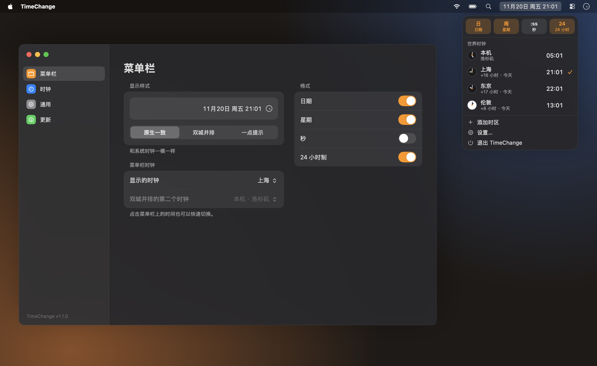
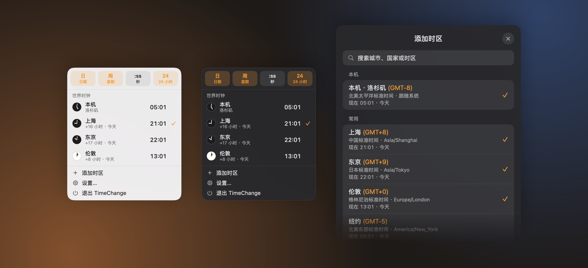

# TimeChange

**macOS 菜单栏多时区时钟 —— 只改显示，不改系统时区和系统时间。**

经常出差旅行？macOS 右上角的时间会自动切到当地，这是对的；但有时你又想看看家里、或者另一个国家现在几点。TimeChange 用一个和系统原生时钟外观一致的菜单栏时间替代它：你可以随时切换成任意时区显示，也可以同时显示两个时区，而**系统时区和系统时间完全不受影响**。

[English](#english) · **[⬇ 下载最新版 DMG](https://github.com/mcporda/TimeChange/releases/latest)**





<p align="center">
  
  <br><sub>实拍菜单栏：TimeChange 的时间与系统原生样式一致，系统时钟缩成最右侧的小表盘</sub>
</p>

## 功能

- **原生外观**：菜单栏时间的字体、字号、格式与系统时钟一致（`11月20日 周五 03:38`）。
- **三种显示样式**
  - **原生一致**：和系统时钟一模一样，只是时区由你决定。
  - **双城并排**：`周五 03:38  19:38`，同时看两个时区，第二个时间淡色显示。
  - **一点提示**：显示的不是本机时间时，前面加一个橙色小点提醒。
- **iOS 风格毛玻璃界面**：下拉面板、时区选择、设置窗口统一风格，跟随系统浅色 / 深色，也可手动指定，并支持 6 种主题色。
- **下拉面板**：点击菜单栏时间弹出世界时钟列表，昼夜表盘一目了然，点一下即可切换；顶部一排快捷开关切换日期 / 星期 / 秒 / 24 小时。
- **时区选择**：本机、常用城市、全部时区分组显示，每个时区标出缩写、全称和当地现在几点，支持中英文搜索。
- **本机时钟跟随系统**：旅行时自动切到当地时区。
- **默认常用时区**：本机、上海、东京、伦敦，可任意添加、改名、排序、删除（支持中英文搜索城市）。
- **格式开关**：日期、星期、秒、24 小时制。
- **隐藏系统数字时钟**：运行时把系统时钟切换为「模拟」小图标，退出时自动恢复（只改显示样式）。
- **自动更新**：从 GitHub Releases 检查新版本，一键更新。
- **登录时启动**、只允许运行一个实例、不占用 Dock。

## 安装

**下载安装（推荐）**：到 [Releases](https://github.com/mcporda/TimeChange/releases/latest) 下载 `TimeChange-x.y.z.dmg`，打开后把 TimeChange 拖进「应用程序」。支持 Apple 芯片和 Intel，需要 macOS 14 及以上。

> [!WARNING]
> **首次打开提示「无法验证开发者」/「已损坏」怎么办？**
> 本项目暂未经过 Apple 公证（需要付费开发者账号），这是正常现象，任选一种方法即可：
> 1. **终端执行一行命令（最简单）**：
>    ```bash
>    xattr -dr com.apple.quarantine /Applications/TimeChange.app
>    ```
> 2. **系统设置**：先双击打开一次 → 弹窗点「完成」→ 打开「系统设置 → 隐私与安全性」→ 拉到底部，在 TimeChange 旁点「**仍要打开**」→ 输入密码确认。
>
> 只需操作一次，之后的自动更新不会再提示。

**自动更新**：TimeChange 每天会检查一次 GitHub 上的新版本。有更新时，下拉面板和「设置 → 通用」里会出现「更新到 vX.Y.Z」，点一下即可自动下载、替换并重启。

**从源码构建**（需要 Xcode 命令行工具，Swift 5.9+）：

```bash
git clone https://github.com/mcporda/TimeChange.git
cd TimeChange
./build.sh
open ~/Applications/TimeChange.app
```

> 提示：按住 ⌘ 拖动菜单栏上的时间，可以调整它的位置。

## 工作原理

- 菜单栏项是一个 `NSStatusItem`，每秒对齐整秒刷新；时间用 `DateFormatter` 按所选时区格式化，从不调用任何修改系统时区 / 时间的 API。
- 「隐藏系统数字时钟」只写入 `com.apple.menuextra.clock IsAnalog`（系统时钟的显示样式），并在退出时恢复原值。
- 界面使用 SwiftUI，代码在 [`Sources/main.swift`](Sources/main.swift)（逻辑）和 [`Sources/UI.swift`](Sources/UI.swift)（界面），无第三方依赖。

## 已知限制

- macOS 不允许第三方 App 删除或修改系统时钟，「模拟」小图标是系统能提供的最小样式。
- 通过「强制退出」结束 TimeChange 时，系统时钟样式不会被自动恢复；重新打开再正常退出即可。

## 开发

```bash
./build.sh                                                     # 构建并安装
~/Applications/TimeChange.app/Contents/MacOS/TimeChange --snapshot docs   # 重新生成 README 截图
./publish.sh 1.1.0 "- 更新要点"                                # 一键发布：打包 DMG、打标签、推送、创建 Release，用户端自动收到更新
```

欢迎提 Issue 和 PR。

## License

[MIT](LICENSE)

---

## English

**A multi-time-zone menu bar clock for macOS that changes only what you see — never your system time zone or clock.**

TimeChange puts a native-looking clock in the menu bar that can show any time zone. Switch between your Mac's local time (which follows you as you travel), home, or any city, or show two zones side by side — without touching system settings.

- Native-matching menu bar text, three styles: **Native**, **Dual**, **Dot hint**
- iOS-style frosted glass UI: light / dark / follow system, 6 accent colors
- Dropdown world-clock list with day/night dials and quick format toggles
- Time zone picker grouped by local / common / all, with abbreviations and current local time
- Defaults: Local, Shanghai, Tokyo, London — add, rename, reorder, delete freely
- Date / weekday / seconds / 24-hour toggles
- Optionally shrinks the system clock to its analog icon while running, restored on quit
- Launch at login, single instance, no Dock icon

- Built-in updater: checks GitHub Releases daily, one-click update

Install: download the DMG from [Releases](https://github.com/mcporda/TimeChange/releases/latest) and drag TimeChange to Applications (Apple silicon + Intel, macOS 14+). The app is not notarized yet. If macOS says it "cannot verify the developer", run `xattr -dr com.apple.quarantine /Applications/TimeChange.app`, or open System Settings → Privacy & Security and click **Open Anyway**. Or build from source: `./build.sh`.
